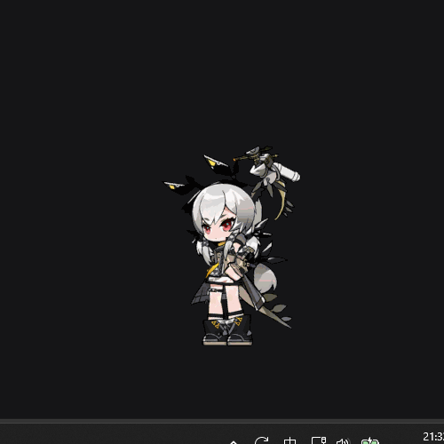
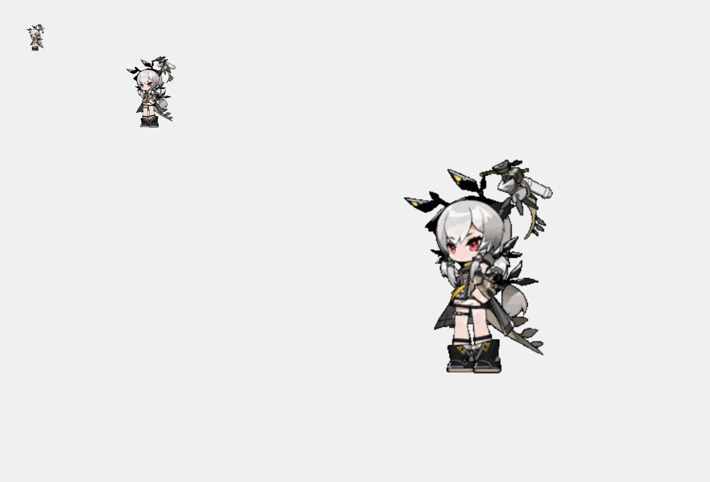
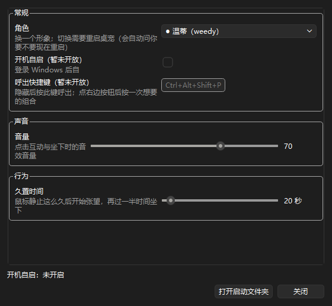

# deskPet

> 一只住在 Windows 桌面上的透明宠物。基于 **PySide6** 从零实现，不联网、不写注册表、不装服务。



温蒂是一个**始终置顶**的透明窗口：**没画到人的地方点得到桌面**（真点击穿透），会待机呼吸、
挥手、左右走动、张望、坐下休息；鼠标久置不动时她会自己换姿势，你一动她就回来。

除此之外还有一整套桌面级交互：**10 档缩放**、**拖动记住位置**、**全局热键藏起来再叫回来**、
**音效**、**开机自启**、**设置窗口改完即生效**，以及一个把整只宠物变成**会跟着你敲键盘按键联动**
的「**键盘形态**」。

---

## 目录

- [它长什么样](#它长什么样)
- [功能一览](#功能一览)
- [快速开始](#快速开始)
- [键盘形态（KV）](#键盘形态kv)
- [自定义素材包](#自定义素材包)
- [配置与数据](#配置与数据)
- [命令行](#命令行)
- [从源码运行与构建](#从源码运行与构建)
- [项目结构](#项目结构)
- [实现要点](#实现要点)
- [已知取舍](#已知取舍)
- [故障排查](#故障排查)
- [参与贡献](#参与贡献)
- [许可](#许可)

---

## 它长什么样

| | |
| --- | --- |
|  | 窗口是**逐帧按不透明像素**生成遮罩的：人形以外的位置**真的**会把鼠标消息透给底下的窗口，不是"看起来透明"。 |
|  | 同一个形象在 10 个档位下的实际尺寸。**只记档号不记像素**，换显示器不会跑到屏幕外。 |
|  | 设置窗口，四组设置，除"角色 / 边缘抗锯齿"外**改完立即生效**。 |

---

## 功能一览

### 宠物本体

| 功能 | 说明 |
| --- | --- |
| **真·透明 + 点击穿透** | 素材是带 alpha 的 PNG，运行时按当前帧生成 `QRegion` 遮罩。**没有色键**。 |
| **始终置顶** | 不带任务栏按钮，不抢焦点。 |
| **10 档缩放** | 默认按屏幕高度自适应（约占 24%）。缩放时**右下角锚点不动**；手动拖过位置后优先待在你放的地方。 |
| **拖动与位置记忆** | 只有按在**人物身上**才起拖（空白处仍然穿透）；松手后位置写进配置，下次启动还在那儿。 |
| **久置行为** | 鼠标静止 N 秒（默认 20）→ 张望；再等 N/2 秒 → 坐下休息。鼠标一动立刻回到待机。拖动/点菜单时计时暂停归零。 |
| **动画播放** | 帧率由素材决定（默认 12 fps，自带素材为 30 fps），支持循环 / 往返 / 一次性三种播放方式。 |
| **镜像翻转** | 按状态分别记忆（`idle` / `waiting` / `rest` 各有各的开关）。 |
| **音效** | 启动音 / 双击互动音 / 坐下音；每个逻辑名可以配一组音频，播放时随机挑一个。 |
| **双击挥手** | 双击温蒂 → 挥手一次 + 互动音。 |

### 桌面集成

| 功能 | 说明 |
| --- | --- |
| **全局热键隐藏/呼出** | 默认 `Ctrl+Alt+Shift+P`，可在设置里改。热键被占用时**自动回退**到备选组合；一个可用的都没有时，菜单里的"隐藏宠物"会**故意灰掉**。 |
| **隐藏是保留状态** | 帧、档位、位置、姿势全留着，动画计时器暂停（不烧 CPU），呼出时从原来那一帧接着播。 |
| **单实例保护** | 命名互斥体，重复双击**安静退出**（不会开出第二只）。 |
| **重启自己** | 换角色时可以选择就地重启，程序拉起新实例、放锁、再退出。 |
| **开机自启** | 在系统「启动」文件夹里建一个指向当前 exe 的快捷方式；**勾选成功 = 建好并且能读回来目标正确**（不是"文件在就算成功"）。 |
| **设置窗口** | 角色 / 开机自启 / 呼出快捷键 / 音量 / 久置时间 / 边缘抗锯齿 / 键位布局 / 键位映射。 |

### 键盘形态（KV）

| 功能 | 说明 |
| --- | --- |
| **一键变身** | 右键 → `开启KV`，宠物本身变成一台 Q 版键盘，**同一个窗口**（不新开窗口、不重置档位、右下角锚点不动）。 |
| **按键联动** | 真实按下键盘上的键 → 画面上对应的键帽被按下、对应的手落下去。 |
| **键位映射可配** | 设置窗口里逐格录制：点一下、按一个键，绑定完成。支持**鼠标五个键**与**单独的修饰键**。 |
| **多布局** | 支持 `1*4` / `1*6` / `1*8` / `2*4` / `2*6` / `2*8` 六种布局。**同一份键位配置在所有布局通用**。 |

---

## 快速开始

### 方式一：下载便携版（推荐给普通用户）

1. 下载 `deskPet-<版本>-win64.zip`，**解压到任意可写目录**（例如 `D:\deskPet`）。
2. 双击 `deskPet.exe`。
3. 温蒂出现在屏幕右下角。

- **目标机器不需要装 Python**，运行环境（Python + PySide6 + FFmpeg）已经打包在内。
- ⚠ **不要**放在 `C:\Program Files\` 这类需要管理员权限的目录——桌宠要在自己旁边写日志与配置。
- ⚠ **不要**只把 `deskPet.exe` 单独拷走，`_internal\` 文件夹要一起搬。
- 退出：**右键点温蒂 → `退出`**。

> 详细用法见 **[操作指引.md](操作指引.md)**。

### 方式二：从源码运行

```powershell
pip install -r requirements.txt
python run.py
```

`run.py` 是开发入口，会把 `src/` 加进搜索路径再调用 `deskpet.app.run()`。

> ⚠ **不能只装 PySide6**：渲染链路（抗锯齿与低阈值遮罩）在模块顶层 import **NumPy**，
> 少装它启动就会 `ModuleNotFoundError: No module named 'numpy'`。
> 依赖的真值在 `pyproject.toml` 的 `dependencies`（task21 CODE-01 统一了这里）。

---

## 键盘形态（KV）

右键 `开启KV`，宠物会从人物变成一台键盘。此后**真实按键会被点亮**——你在打什么，她就在按什么。

**怎么用**：

1. 右键 → `开启KV`。
2. 右键 → `设置…` → **键盘** 组：
   - `键位布局`：选一个布局（下拉里只列素材包**真的有的**）。
   - `键位映射`：点某个键位格子 → 按下你想绑定的键 → 完成。`Esc` 取消并保留原值。
3. 回桌面，敲键盘，看键帽亮。

**约定**：

- **键身份是 `r{行}k{序号}`，序号从中间往两边增加**（8 列是 `7 5 3 1 2 4 6 8`）。
  于是 **4 键 ⊂ 6 键 ⊂ 8 键**，同一份坐标、素材、配置可以跨布局复用。
- **键位映射不带布局前缀**：一个键 id 在所有布局里指同一个键，配置一次全局通用。
- **没配的键永远不会亮**。
- 同一个键绑到多个键位**是允许的**（不自动解绑）。
- 键盘形态下，`坐下休息` 与 `镜像翻转` 会灰掉（KV 没有动作、不镜像）。
- 素材包如果没有 `keyview` 段，KV 这一项会灰掉——**完全正常**，不影响宠物形态。

---

## 自定义素材包

自带两个形象：**温蒂**（`weedy`）与**温蒂（倾听）**（`weedy_sightseer`）。
你也可以放自己的素材包进去。

### 目录结构

```
data/pets/我的形象/          ← 文件夹名就是形象的名字
├── asset.json              必需：素材索引
├── frames/                 必需：帧图片（透明背景 PNG）
│   ├── idle_00.png
│   └── ...
├── sounds/                 可选：音效
│   └── waving_00.wav
└── keyview/                可选：键盘形态的图
    └── ...
```

把文件夹放进 `data/pets/` 下，重启桌宠即可在 `设置… → 角色` 里选到它。
**同名时用户包优先于自带包。**

### `asset.json`

```json
{
  "name": "我的形象",
  "description": "一句话说明",
  "cell": [500, 500],
  "actions": {
    "idle":  { "frames": ["idle_00.png", "idle_01.png"], "fps": 30.0 },
    "rest":  { "frames": ["rest_00.png", "rest_01.png"], "fps": 30.0 }
  },
  "sounds": {
    "start":  ["waving_00.wav"],
    "waving": ["waving_00.wav"],
    "rest":   ["rest_00.wav"]
  }
}
```

| 字段 | 约定 |
| --- | --- |
| `name` / `description` | 展示名与一句话说明。 |
| `cell` | **必须等于帧图片的真实像素尺寸**。对不上只会警告，画面照样出。 |
| `actions.<动作>.frames` | **顺序就是播放顺序**，要写全，程序**不猜**命名规律。 |
| `actions.<动作>.fps` | 播放帧率，可写小数。不写按默认 12 fps。 |
| 规范动作名 | `idle` / `running_left` / `running_right` / `waiting` / `rest` / `waving`。用别的名字也能加载，但只会被当成"播一次就停"的演出。 |
| `sounds` | 逻辑名只有三个：`start`（启动音）/ `waving`（双击互动音）/ `rest`（坐下音）。每个都是**文件名数组**，播放时随机挑一个。不声明就没有声音。 |
| `keyview` | 可选的键盘形态段，见 [键盘形态（KV）](#键盘形态kv)。段缺失、为 `null`、甚至整个坏掉，都**只影响键盘形态**，绝不影响宠物形态的加载。 |

> 素材来源是 GIF 的话，需要自己用抽帧工具把 GIF 拆成 PNG 序列

### 健壮性

素材包坏了**不会让程序起不来**：所有素材包会做一次"列全校验"，
坏的那一项被记下来、能用的部分照常用；`设置… → 角色` 里坏包也会被列出来，带一个 `⚠ 不可用` 标记。

---

## 配置与数据

`data/` 文件夹在 `deskPet.exe` 旁边自动生成：

| 文件 | 作用 |
| --- | --- |
| `data/config.json` | 你的设置。**只在真的改了值时才会出现**。 |
| `data/deskpet.log` | 运行日志。排查问题的第一入口（满 256 KB 滚动成 `.1`，只留 1 份）。 |
| `data/crash.log` | **只有崩溃时才出现**。平时不存在就是好消息。 |
| `data/pets/<名字>/` | 你自己导入的素材包。 |

```json
{
  "pet": "",
  "hotkey": "Ctrl+Alt+Shift+P",
  "volume": 70,
  "idle_seconds": 20,
  "size_level": 6,
  "position": "2036,916",
  "antialias": false,
  "form": "",
  "keyview_layout": "",
  "keyview_keys": {},
  "mirror": { "idle": true }
}
```

| 键 | 含义 |
| --- | --- |
| `pet` | 素材包命名空间。**空串 = 还没表态**，此时用自带默认形象。 |
| `hotkey` | 呼出快捷键。空串 = 没设置（隐藏功能禁用）。 |
| `volume` | 音效音量 0–100。 |
| `idle_seconds` | 久置时间（秒）。 |
| `size_level` | 上次用的档位 1–10（**不存像素**）。 |
| `position` | 上次拖动到的左上角 `"x,y"`。空串 = 贴右下角。 |
| `antialias` | 边缘抗锯齿开关。**重启生效**。 |
| `form` | 形态。`""` = 宠物形态，`"keyview"` = 键盘形态。**记忆上次用的**。 |
| `keyview_layout` / `keyview_keys` | 键盘布局与键位映射。 |
| `mirror` | 按状态记的翻转开关。 |

**手改 `config.json` 是安全的**：文件坏了、字段类型不对、有未知键——程序都**照常启动**，
坏的那一项退回默认值并往日志里写一条警告。**绝不会因为配置坏了起不来。**

**恢复出厂设置**：关掉桌宠，把整个 `data/` 删掉（或改名备份），再启动。

---

## 命令行

`deskPet.exe` 支持几个**只读查询**与调试参数：

```
deskPet.exe --list-pets          列出所有素材包与校验结论
deskPet.exe --list-actions       列出动作、帧数、帧率与来源
deskPet.exe --list-sizes         列出 10 个档位的像素尺寸与本机自适应结果
deskPet.exe --version            显示版本
deskPet.exe --help               显示全部参数
```

还有 `--pet` / `--action` / `--size-level` / `--position` / `--exit-after` 等启动参数。

> ⚠ 打包的 exe 是**不带控制台**编译的，在 `cmd` 里运行时输出不会显示在同一窗口。
> 只读查询建议直接看日志。

---

## 从源码运行与构建

### 环境要求

| 项 | 要求 |
| --- | --- |
| 操作系统 | **Windows 10 / 11（64 位）** |
| Python | **3.14**（源码运行 / 构建时需要） |
| 运行时依赖 | **PySide6** + **NumPy**（真值见 `pyproject.toml` 的 `dependencies`） |
| 构建依赖 | **PyInstaller 6.x** |
| 网络 | **不需要**（程序运行期完全不联网） |

### 运行

```powershell
pip install -r requirements.txt
python run.py
```

依赖清单的真值是 `pyproject.toml`，`requirements.txt` 只是给"不会读 pyproject"的
人准备的同一份（**两处一起改**）。

### 构建便携版

```powershell
pip install PyInstaller
pyinstaller --noconfirm deskpet.spec
```

产物在 `dist/deskPet/`（onedir 便携版）。构建后请**手动打 zip**：

```powershell
Compress-Archive -Path dist\deskPet -DestinationPath dist\deskPet-<版本>-win64.zip
```

构建配置 [`deskpet.spec`](deskpet.spec) 里有几处是**踩过坑才写上去的**，改之前请先读它的注释：

- **onedir 而不是 onefile**：`paths.program_dir()` 打包后取 `sys.executable` 的父目录，
  用户数据 `data/` 就落在 exe 旁边（可写、可备份）。onefile 会把程序目录变成临时解包目录。
- **`assets/` 与 `tools/*.ps1` 的落点不一样**：`assets/` 要进 `_internal/`（= `resource_dir()`），
  而 `tools/*.ps1` **必须在 exe 同级**（= `program_dir()/tools`）。漏掉后者的症状是
  "打包后开机自启永远显示不可用"，而源码运行完全看不出来。
- **Qt 的 multimedia 插件与 FFmpeg 动态库不能少**：漏掉的表现是"开发机能响、打包后没声音"。
- **构建完自动删掉 `data/`**：交付物必须"从没运行过"。

### 自检

仓库里的 `tools/check_task*.py` 是逐阶段的验收脚本（大量断言，覆盖 offscreen 与真平台两种情况）。
脚本名与功能阶段一一对应，例如：

```powershell
python tools\check_task04.py        # 尺寸档位与缩放
python tools\check_task10.py        # 音效与双击手势
python tools\check_task17.py        # 键盘形态：能切过去、能画出来
python tools\check_task18.py        # 键盘形态：按键联动
python tools\check_task20.py        # 键位映射的视角、特殊键与鼠标键
```

带 `_real` 后缀的那一份跑的是**真平台**用例（真窗口、真遮罩、真穿透），
不带后缀的跑在 `QT_QPA_PLATFORM=offscreen` 上。

---

## 项目结构

```
deskPet/
├── README.md            本文件
├── 操作指引.md           使用者手册（随分发包一起发）
├── run.py               开发入口：改 sys.path 后调用 run()
├── main.py              打包入口：顶层静态 import（打包工具才收得全模块）
├── deskpet.spec         PyInstaller 打包配置（手工维护的交付物）
├── assets/<命名空间>/    自带素材（只读）
│       asset.json       素材索引        frames/*.png   显示帧
│       sounds/*         音效            keyview/*      键盘形态的图
├── data/                用户数据（不进版本控制，首次运行才生成）
├── src/deskpet/         源码包
├── tools/               自检脚本 / 打包与自启用的 PowerShell 脚本
└── docs/                文档截图
```

源码按**职责**分层，上层可以依赖下层，下层**不许**反向依赖：

| 层 | 模块 |
| --- | --- |
| 基础 | `paths` `logger` `errors` `config` |
| 数据 | `nsrules` `pet_spec` `pet_loader` `size` `hit_test` `sounds` `keyview_spec` `autostart` |
| 逻辑 | `animation` `idle_state` `cursor_watch` `drag` `mirror` `geometry` `key_listener` |
| 系统 | `win32` `hotkey_spec` `hotkey` `single_instance` `restart` |
| 视图 | `rendering` `keyview_render` `pet_window` `control_bar` `context_menu` `settings` `keycapture` `keygrid` |
| 装配 | `app` |

**两个入口不能合并**：`run.py` 是运行时改搜索路径的开发脚本；`main.py` 的 import 写在顶层，
静态分析（打包）才收得全模块。两者指向**同一个** `run()`。

---

## 实现要点

这些是本项目**刻意选择的做法**，也是踩坑之后定下来的：

- **点击穿透用 `setMask(QRegion)`**，按当前帧的不透明像素生成窗口区域。
  代价是边缘锯齿，这是**已知且接受的取舍**（task15 另提供了一个**默认关闭**的可选抗锯齿）。
  ⚠ 遮罩是**二值**的，会吃掉抗锯齿的过渡像素——所以开抗锯齿时**必须同时降低遮罩阈值**。
- **键身份与"摆第几格"解耦**：`r{行}k{序号}` 中间往外编号，让 4 键成为 8 键的居中子集，
  从结构上杜绝了参考实现那种"置换表错位"的 bug。
- **读键用 `GetAsyncKeyState` 轮询（8 ms）**，**不装键盘钩子**（`SetWindowsHookEx` 有被系统摘掉的风险），
  **不开忙等线程**。实测 8 个绑定一轮 16.4 µs ≈ **0.205% 单核**。
  ⚠ 判据是**高字节** `& 0x8000`：低 8 位是"自上次调用以来按过"的历史位，写成"非零即按下"会导致点一下键永远亮着。
- **键态源可注入**：`KeyStateSource = Callable[[int], bool]`，产品给 Win32 实现，自检注入假源
  （本机 `SendInput` 造合成按键被拒，所以"真按键点亮"这一条**只能人工确认，自检脚本没有假装验过**）。
- **合并复绘**：按键变化不当场重绘，16 ms 的单次定时器重排，期间再来变化只重置。实测 60 次变化 → 1 次重绘。
- **帧缓存上限按内存预算算**，不是拍一个常量：常量上限小于动作帧数会导致"每帧都在重算"。
- **配置写入原子**（临时文件 + `os.replace()`），失败不留半截文件；**读取永不致命**。
- **`config.json` 只在值真的变了时才落盘**——所以没动过设置就没有这个文件，属正常。
- **`win32.py` 是全项目唯一的 `ctypes` 出口**，非 Windows 上导入不炸、只报"不可用"。

源码里的注释记录了每条约定**为什么**是这样，改动前建议先读一遍相关模块的模块级 docstring。

---


## 故障排查

**第一步永远是看日志**：打开 `data/deskpet.log`，看最后 30 行。每次启动都会有一行
`===== 2025-01-01 12:00:00 =====` 作为分隔，从最后一行那里往下读。

| 现象 | 原因与处理 |
| --- | --- |
| **双击 exe 完全没反应** | ① 文件夹在 `Program Files` 等没写权限的地方 → 换到桌面/D 盘；② 已经有实例在跑了（第二次双击会**安静退出**，这是正常的）；③ 看日志最后几行。 |
| **弹窗说"用户数据目录不可用"** | 包所在目录不可写。换到普通目录即可。 |
| **没有声音** | ① 检查 `设置… → 音量`；② 看日志里的 `音效 …` 那一行——`无音效` 表示素材没声明音效，属正常；③ 确认系统音量与输出设备。 |
| **快捷键按了没反应** | ① 组合被别的程序占用 → 换一个；② 日志里会写 `原快捷键 X 不可用，已改用 Y`（程序会自动回退）；③ 菜单里 `隐藏宠物` 变灰 = 一个能用的都没有。 |
| **它跑到屏幕外面了** | 程序不会让它出屏（切档、拖动都会夹取）。若显示器配置变过，删掉 `config.json` 里的 `position` 再启动即可回到右下角。 |
| **启动后立刻退出、rc=2** | 素材包不可用。日志会明确说哪个包、什么问题。删掉 `config.json` 里的 `pet` 值可回到默认形象。 |
| **键盘形态菜单项是灰的** | 当前素材包没有可用的 `keyview` 布局（自带 `weedy_sightseer` 就是这种正常情况）。 |
| **按键不亮** | 该键位还没在 `设置… → 键盘 → 键位映射` 里配过；**没配的键永远不亮**。 |
| **想彻底重来** | 关掉桌宠 → 删掉 `data/` → 重新启动。 |

**它生成了哪些东西**（想清理干净时）：

1. `data/` 文件夹（在 `deskPet.exe` 旁边）——删。
2. 「启动」文件夹里的 `deskpet.lnk`（若开过自启）——在 `设置…` 里取消勾选即可，或手动删。
3. 没了。**没有注册表项、没有系统服务、没有联网。**

---

## 参与贡献

1. **动手前先读一遍相关模块的模块级 docstring** —— 绝大多数"看起来奇怪但就是该这样写"
   的地方，注释里都写了原因（哪条路试过、为什么会坏）。
2. **一次只做一个阶段**，每阶段完成后必须能独立运行。。
3. 改完请跑一遍相关的 `tools/check_*.py` 自检。
4. 遇到"文档说的和实际不一致"→ **以实现为准**，并立刻回来修订文档（不要留两份说法）。

---

## 许可

本项目的开源许可证见仓库根目录的 `LICENSE` 文件。

> ⚠ **自带素材（`assets/`）不在代码许可证的覆盖范围内。**
> 其中的角色形象版权归原作者所有，仅随本项目作**演示用途**。（来源上海鹰角网络出品的网络游戏《明日方舟》中的温蒂形象，keyview素材来自Jongyeol的《冰与火之舞》mod LineKeyViewer）
> 二次分发或商用前请自行确认素材授权；若要用于自己的项目，
> 建议按 [自定义素材包](#自定义素材包) 换成你有权使用的素材。
